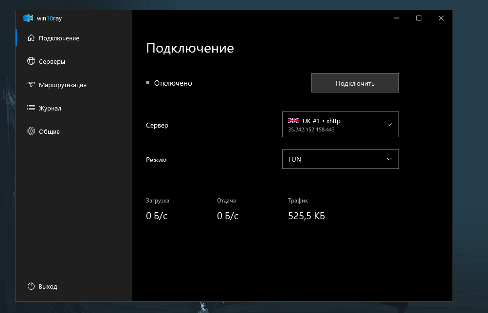

# Win10ray

[](https://github.com/zephrx0/Win10ray/releases/latest)
[](https://github.com/zephrx0/Win10ray/releases/latest)
[](https://dotnet.microsoft.com/download/dotnet/8.0)

Клиент Xray для Windows с интерфейсом в стиле Windows 10. C#, WPF, без веб-компонентов.



## Возможности

- VLESS, VMess, Trojan, Shadowsocks. Подписки, QR-коды и флаги серверов. Узлы с одинаковым названием в одной подписке объединяются.
- [JSON-профили Xray](docs/JSON.md): серверы и балансировщики провайдера сохраняются одной записью.
- OpenVPN и импорт `.ovpn` доступны в экспериментальной версии.
- Системный прокси и TUN, обход VPN для выбранных приложений, блокировка рекламы и трекеров, DNS over HTTPS.
- Трей, автоподключение, переключение недоступных серверов, тёмная и светлая темы, русский и английский интерфейс.

## Скачать

[Стабильная версия](https://github.com/zephrx0/Win10ray/releases/latest) · [Экспериментальная версия с OpenVPN](https://github.com/zephrx0/Win10ray/releases/tag/v1.4.3-experimental.2) · [Все релизы](https://github.com/zephrx0/Win10ray/releases)

Запустите `Win10ray-Setup-*.exe`, импортируйте ссылку или подписку и нажмите «Подключить». Для первого включения TUN подтвердите запрос администратора.

Канал обновлений выбирается в **Общие → Обновления** и в `updater.exe`. Экспериментальные версии могут содержать ошибки, устанавливаются после предупреждения. Для возврата выберите стабильный канал.

## Данные и приватность

Профиль в `%AppData%\Win10ray` зашифрован Windows DPAPI и привязан к пользователю Windows. Старые данные переносятся автоматически. HWID включён по умолчанию и передаётся только серверу подписки; его можно отключить. QR-коды создаются локально и содержат секретные ссылки. [Подробности](docs/BUILD.md#данные-и-ограничения).

## Сборка

Windows x64, .NET SDK 8. Ядра загружаются отдельно с проверкой SHA-256.

```powershell
powershell -NoProfile -ExecutionPolicy Bypass -File scripts/Prepare-Cores.ps1
dotnet build
dotnet publish -c Release -p:PublishProfile=Windows
```

[Установщик, тесты и компоненты](docs/BUILD.md).

---

## English

A native Xray client with a Windows 10 style interface. Built with C# and WPF.

- VLESS, VMess, Trojan and Shadowsocks; subscriptions, QR codes and server flags. Nodes with the same name within a subscription are grouped.
- [Xray JSON profiles](docs/JSON.md) retain provider servers and balancers in one entry.
- OpenVPN and `.ovpn` import are available in the experimental build.
- System proxy and TUN, VPN bypass for selected apps, ad and tracker blocking, DNS over HTTPS.
- Tray, automatic connection and server failover, light/dark themes, English/Russian interface.

### Download

[Stable release](https://github.com/zephrx0/Win10ray/releases/latest) · [Experimental OpenVPN build](https://github.com/zephrx0/Win10ray/releases/tag/v1.4.3-experimental.2) · [All releases](https://github.com/zephrx0/Win10ray/releases)

Run `Win10ray-Setup-*.exe`, import a link or subscription and click **Connect**. TUN requires administrator approval on first use.

Choose the update channel in **General → Updates** or `updater.exe`. Experimental builds may contain bugs and require confirmation. Select Stable to return to a stable release.

The profile is encrypted with Windows DPAPI for the current Windows user. Legacy data migrates automatically. HWID is enabled by default for subscription requests and can be disabled. QR codes are generated locally and contain private links.

### Build

Windows x64 and .NET SDK 8 are required. Run the three commands above. [Installer, tests and component licenses](docs/BUILD.md).
